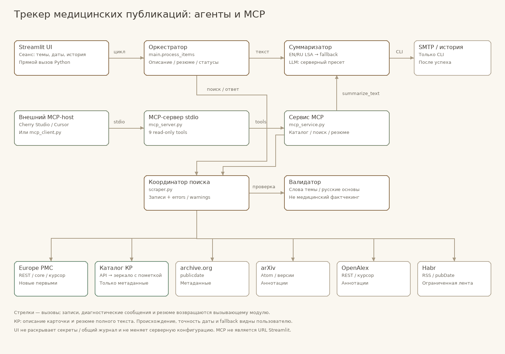

# Трекер публикаций

Мульти-агентный трекер ищет свежие публикации по заданным темам, проверяет, что тема действительно есть в тексте, и составляет короткое резюме. Источники сейчас — [archive.org](https://archive.org), [arXiv](https://arxiv.org), [OpenAlex](https://openalex.org), [Habr](https://habr.com) и [Europe PMC](https://europepmc.org), а также [Рубрикатор клинических рекомендаций Минздрава РФ](https://cr.minzdrav.gov.ru/). Результаты смотрят в панели Streamlit. Письма по умолчанию не отправляются. Те же агенты доступны как MCP-tools через `mcp_server.py` (см. раздел «MCP-сервер»): у каждого из шести источников есть свой сырой tool `search_<источник>`, плюс единый проверенный `search_publications`.

Один цикл обработки выглядит так: панель передаёт темы, источники и даты оркестратору, скрапер опрашивает агентов-источники, валидатор отвечает «да» или «нет», суммаризатор возвращает резюме, оркестратор отдаёт результат обратно на панель.

## Схема агентов

Та же страница открывается на вкладке «Схема агентов» в панели. Кнопки Light, Classic, Present, Export и легенда остаются на английском; подписи агентов — на русском. Картинка ниже — это [`diagr/agents.html`](diagr/agents.html); нажатие открывает интерактивную схему.

[](diagr/agents.html)

Стрелки на схеме — это данные, которые агент возвращает вызывающему:

| Откуда | Куда | Что передаётся |
| --- | --- | --- |
| Панель | Оркестратор | запуск: темы, источники, диапазон дат |
| Оркестратор | Панель | результат: карточки с резюме |
| Оркестратор | Скрапер | темы и даты |
| Скрапер | Оркестратор | принятые записи |
| Скрапер | Агент archive.org / arXiv / OpenAlex / Habr / Europe PMC / Минздрав | вызов `fetch` |
| Агент-источник | Скрапер | записи: название, ссылка, аннотация; у arXiv ещё авторы и даты; у OpenAlex также DOI, площадка и число цитирований; у Habr также теги; у Минздрава также коды МКБ-10, возраст и год пересмотра |
| Скрапер | Валидатор | одна запись |
| Валидатор | Скрапер | да или нет |
| Оркестратор | Суммаризатор | текст аннотации или страницы |
| Суммаризатор | Оркестратор | резюме |
| Оркестратор | Нотификатор | письмо, если почта включена |

Нотификатор в цикл ничего не возвращает. На схеме это пунктир «почта выкл».

## Как проходит поиск

1. **Панель** (`streamlit_app.py`) или **планировщик** (`main.py`) вызывает `process_items`.
2. **Скрапер** (`scraper.py`) по очереди вызывает `fetch` у каждого подключённого источника. Число `rows` — это лимит на каждый источник, а не на все вместе.
3. Уже виденные идентификаторы отбрасываются, если включён пропуск истории.
4. **Валидатор** (`validator.py`) оставляет запись, только если в тексте есть все слова хотя бы одной темы.
5. **Оркестратор** берёт аннотацию, если в ней не меньше 200 символов. Иначе скачивает HTML-страницу, вырезает `script` / `style` / `noscript` и обрезает текст до лимита символов.
6. **Суммаризатор** (`summarizer.py`) строит резюме алгоритмом LSA из библиотеки [Sumy](https://github.com/miso-belica/sumy). Токенизатор — английский. Число предложений задаётся в панели, по умолчанию 3.
7. При включённой почте **нотификатор** (`notifier.py`) отправляет письмо через SMTP с STARTTLS. В панели кнопка поиска всегда вызывает цикл с `send=False`.

Журнал пишется в терминал и в `main.log` логгером `archiv_tracker`.

## Темы и проверка релевантности

Тема — строка из `config.yaml` или из боковой панели, по одной фразе на строку. Фраза режется на слова по пробелам и дефисам. «medical multi-agent» становится словами `medical`, `multi`, `agent`. Порядок слов не важен: подойдёт заголовок, где эти слова стоят в другом порядке.

Запись проходит, если **все** слова одной темы нашлись в тексте. Сравнение без учёта регистра.

- Короткая аббревиатура (все буквы заглавные и их не больше пяти, либо в слове меньше четырёх букв и цифр) ищется только как целое слово. `RAG` не срабатывает внутри `storage` или `fragment`.
- Более длинное слово совпадает и как префикс: `agent` находит `agents` и `agentic`.

Поля проверяются так. Сначала заголовок и аннотация вместе: слова темы могут лежать в разных полях. Для arXiv и OpenAlex этого достаточно, страницу публикации валидатор не скачивает; у OpenAlex страница загружается только тогда, когда аннотации в источнике нет. Для archive.org и Habr, если в заголовке и описании темы нет, загружается страница публикации: `https://archive.org/details/<identifier>` или статья на habr.com.

Запрос к самому API устроен так же по смыслу, но синтаксис у источников разный. archive.org ищет фразу целиком: `("medical multi-agent")`. arXiv собирает слова темы через `AND` и ищет их по всем полям (`all:`), с тем же правилом префикса. OpenAlex ищет по заголовку и аннотации (`title_and_abstract.search`): слова одной темы разделяются пробелом — это `AND`, темы между собой разделяются символом `|` — это `OR`. Поиск OpenAlex приводит слова к начальной форме, поэтому `agent` находит и `agents`, и `agentic`. Habr, как и archive.org, ищет фразу целиком — через параметр `q` RSS-поиска, по одному запросу на тему. Europe PMC ищет фразу целиком в кавычках, темы через `OR`, плюс диапазон `FIRST_PDATE`.

## Диапазон дат

Границы включительные: и день «с», и день «по» входят в выборку.

| Режим | Границы |
| --- | --- |
| Неделя | сегодня минус 7 дней … сегодня |
| Месяц | то же число месяц назад … сегодня; если такого числа нет, берётся последний день месяца |
| Произвольный | две даты «С» и «По»; если «С» позже «По», запуск в панели блокируется |

В панели по умолчанию выбрана неделя. Планировщик и прямой вызов агентов без дат тоже берут неделю.

archive.org добавляет к запросу `publicdate:[ГГГГ-ММ-ДД TO ГГГГ-ММ-ДД]`. API разворачивает эти даты на полные сутки, поэтому конечный день входит целиком. Сортировка — по `publicdate` по убыванию.

arXiv добавляет `submittedDate:[ГГГГММДД0000 TO ГГГГММДД2359]` в GMT: это дата первой отправки препринта. Отдельный проход по `lastUpdatedDate` добирает новые версии, у которых в диапазон попала дата обновления, а не первой отправки. Между запросами к API выдерживается пауза 3 секунды. Ответ — Atom XML с `https://export.arxiv.org/api/query`.

OpenAlex добавляет к фильтру `from_publication_date:ГГГГ-ММ-ДД` и `to_publication_date:ГГГГ-ММ-ДД`: это дата публикации работы, границы включительные. Сортировка — по `publication_date` по убыванию, записи листаются курсором. Ответ — JSON с `https://api.openalex.org/works`. Работы, у которых в OpenAlex известен только год без точной даты, в выборку не попадают.

Habr отдаёт в RSS поле `pubDate` в формате RFC 822 (`Thu, 21 May 2026 11:51:41 GMT`) и не гарантирует порядок записей, поэтому по дате агент фильтрует и сортирует сам: в выборку попадают записи с `pubDate` внутри диапазона, свежие первыми. Записи без даты отбрасываются.

## Что возвращает агент-источник

Общие поля записи: `source`, `identifier`, `title`, `url`, `abstract`.

Агент archive.org кладёт в `identifier` идентификатор archive.org, в `url` — страницу details, в `abstract` — поле `description`.

Агент arXiv кладёт в `identifier` строку вида `arxiv:<id>`, в `url` — страницу abs, и добавляет `authors`, `published`, `updated`. Резюме и почту этот агент не делает: он только возвращает записи скраперу.

Агент OpenAlex кладёт в `identifier` строку вида `openalex:<id>` (например, `openalex:W4417100132`), а в `url` — страницу издателя или репозитория из `primary_location`; если её нет, берётся открытый файл из `open_access`, затем DOI и только в конце страница работы в OpenAlex. Аннотация собирается из «перевёрнутого индекса» `abstract_inverted_index`, где каждому слову сопоставлены его позиции в тексте. Кроме общих полей возвращаются `authors`, `published`, `doi`, `venue` (журнал, репозиторий или издатель) и `cited_by_count`.

Агент Habr кладёт в `identifier` строку вида `habr:<номер публикации>`, в `url` — ссылку из тега `link` (без utm-меток), в `abstract` — текст лида статьи, очищенный от HTML и от хвоста «Читать далее». Дополнительно возвращаются `published` (дата из `pubDate`), `authors` (логин на Habr, если лента его отдала) и `tags` (теги публикации через запятую).

Агент Europe PMC кладёт в `identifier` строку вида `europepmc:<PMCID>` (если PMCID нет — `europepmc:<PMID>`), в `url` — страницу статьи в Europe PMC (или карточку PubMed по PMID, затем DOI), в `abstract` — поле `abstractText`, очищенное от HTML-тегов. Дополнительно возвращаются `authors` (строка `authorString`), `published` (дата первой публикации), `doi`, `venue` (название журнала), `cited_by_count`, `keywords` (через запятую), `pmid` и `pmcid`.

Агент Минздрава кладёт в `identifier` строку вида `minzdrav:<slug>` (slug карточки из URL), в `url` — карточку КР на зеркале рубрикатора, в `abstract` — синтезированное описание из названия, кодов МКБ-10, возраста и года пересмотра. Дополнительно возвращаются `icd_codes`, `age_category`, `revision_year`, `status` и `pdf_hint` (подсказка, как получить полный PDF в Telegram-боте). Поле `published` — 1 января года пересмотра, потому что рубрикатор — справочник, а не лента: точной даты публикации у КР нет.

## Панель

Запуск:

```bash
./run_ui.sh
```

Скрипт поднимает Streamlit из `.venv` командой `streamlit run streamlit_app.py`. Адрес по умолчанию — `http://localhost:8501`.

Боковая панель задаёт параметры одного сеанса. Темы и список источников в начале сеанса читаются из `config.yaml`, дальнейшие правки в панели в файл не записываются.

- Темы, по одной в строке.
- Подключённые источники: `archive.org`, `arxiv.org`, `openalex.org`, `habr.com`, `Europe PMC` и `Рубрикатор КР Минздрава` (дополнительный — по умолчанию в списке есть, но не включён в активные в `config.yaml`; выберите его в панели или добавьте `minzdrav` в `sources`). Пустой список блокирует кнопку запуска.
- Диапазон дат: неделя, месяц или произвольный.
- Сколько последних записей запрашивать у каждого источника (5–100, шаг 5, старт 20).
- Число предложений в резюме (1–10, старт 3) и лимит текста страницы (500–10000 символов, старт 2000).
- Пропуск уже просмотренных и запись в историю. В панели оба флажка по умолчанию выключены, чтобы один и тот же поиск можно было повторить. Планировщик, наоборот, пропускает историю и сохраняет найденное.
- Очистка `history.json`.
- Почта в панели выключена и недоступна для включения. Получатель показывается из конфигурации.
- Интервал планировщика только отображается; меняется он в `config.yaml`.

Вкладка «Поиск» запускает один цикл и показывает счётчики, карточки и таблицу. В карточке есть источник, идентификатор, ссылка, резюме и статус. Вкладка «Схема агентов» встраивает `diagr/agents.html`. Внизу поиска раскрывается хвост `main.log` (последние 20 строк).

## Конфигурация

Файл `config.yaml` в корне проекта:

```yaml
topics:
  - "medical multi-agent"

sources:
  - "archive"
  - "arxiv"
  - "openalex"
  - "habr"
  - "europepmc"
  # - "minzdrav"   # дополнительный источник: раскомментируйте, чтобы включить

openalex:
  mailto: ""
  api_key: ""

europepmc:
  email: ""

minzdrav:
  base_url: "https://minzdrav.clinirec.ru"

check_interval_seconds: 3600

send_email: false

email:
  smtp_server: "smtp.gmail.com"
  smtp_port: 587
  username: "your.email@example.com"
  password: "YOUR_EMAIL_PASSWORD"
  from_address: "your.email@example.com"
  to_address: "recipient@example.com"

history_size: 1000
```

`sources` принимает идентификаторы `archive`, `arxiv`, `openalex`, `habr`, `europepmc` и `minzdrav`. Минздрав — дополнительный источник (рубрикатор КР, а не лента новостей), поэтому по умолчанию в `sources` не включён: его можно добавить сюда вручную или выбрать в панели. Блок `openalex` необязательный: `mailto` включает «вежливые» лимиты OpenAlex, `api_key` даёт собственный дневной бюджет вместо общего бесплатного на IP-адрес. Оба значения можно не писать в файл, а задать переменными окружения `OPENALEX_MAILTO` и `OPENALEX_API_KEY`. Блок `europepmc` тоже необязательный: `email` включает «вежливый» пул Europe PMC, значение можно задать окружением `EUROPEPMC_EMAIL`. Блок `minzdrav` необязательный: `base_url` задаёт адрес зеркала рубрикатора (официальный `cr.minzdrav.gov.ru` защищён от автообхода и не имеет публичного API). `send_email: false` оставляет письма выключенными для планировщика. Пароль в интерфейсе маскируется. Реальный пароль в этот файл лучше не класть: для Gmail нужен пароль приложения, а сам секрет надёжнее читать из окружения, если почта понадобится.

## История

`history.json` хранит идентификаторы уже принятых записей. Размер списка ограничен `history_size` (по умолчанию 1000): остаются последние. Скрапер дописывает идентификатор после того, как валидатор запись принял, и только если сохранение истории включено.

Идентификатор archive.org — это identifier архива. Идентификаторы arXiv, OpenAlex, Habr и Europe PMC имеют префиксы `arxiv:`, `openalex:`, `habr:` и `europepmc:`, поэтому одинаковые строки из разных источников не смешиваются. OpenAlex индексирует в том числе препринты arXiv, поэтому одна и та же работа может прийти из двух источников сразу: идентификаторы у неё разные, и история такие повторы не склеивает.

## Почта и планировщик

Планировщик:

```bash
./run_agents.sh
```

Это `python main.py` из `.venv`. APScheduler ставит `process_items` на повтор каждые `check_interval_seconds` секунд (по умолчанию 3600). Остановка — `Ctrl+C`. Если APScheduler не установлен, срабатывает запасной режим: один цикл сразу и процесс завершается.

Письмо уходит, только когда цикл вызван с отправкой и в конфигурации `send_email: true`, а блок `email` заполнен. Тема письма: «Новая публикация (источник): название». В теле — ссылка и резюме. Ошибка SMTP пишется в журнал, остальные публикации цикла продолжают обрабатываться.

## Установка

Нужен Python 3.13. Зависимости перечислены в `requirements.txt`: `requests`, `beautifulsoup4`, `pyyaml`, `sumy`, `apscheduler`, `streamlit`, `pandas`, `mcp`.

```bash
cd /Users/edwfa/Documents/antigravity/brave-mendeleev/multi_agent_archiv
python3 -m venv .venv
source .venv/bin/activate
pip install -r requirements.txt
```

Дальше панель — `./run_ui.sh`, фоновый опрос — `./run_agents.sh`. Короткий порядок действий есть в `USAGE.md`.

Проверка одного поиска без панели:

```bash
source .venv/bin/activate
python scraper.py
```

Скрипт печатает источник, название и ссылку принятых записей. Даты при этом — последняя неделя, история читается и пополняется.

## Состав проекта

```
multi_agent_archiv/
├─ config.yaml          # темы, источники, интервал, почта, размер истории
├─ history.json         # идентификаторы уже принятых записей
├─ main.log             # журнал цикла
├─ main.py              # оркестратор и планировщик
├─ streamlit_app.py     # панель: поиск и вкладка со схемой
├─ scraper.py           # координатор источников
├─ archive_agent.py     # поиск archive.org
├─ arxiv_agent.py       # поиск arXiv
├─ openalex_agent.py    # поиск OpenAlex
├─ habr_agent.py        # RSS-поиск Habr
├─ europepmc_agent.py   # поиск Europe PMC
├─ minzdrav_agent.py    # поиск Рубрикатора КР Минздрава РФ
├─ validator.py         # проверка темы в тексте
├─ summarizer.py        # резюме Sumy LSA
├─ notifier.py          # письмо по SMTP
├─ utils.py             # конфиг, даты, токены темы, история, текст страницы
├─ mcp_service.py       # сервисный слой MCP (логика tools без транспорта)
├─ mcp_server.py        # MCP-сервер по stdio (tools поверх агентов)
├─ mcp_client.py        # короткоживущий MCP-клиент по stdio (демо)
├─ .cursor/mcp.json     # подключение сервера к Cursor
├─ diagr/
│  ├─ agents.html       # интерактивная схема агентов
│  └─ agents.architecture.json
├─ tests/
│  └─ test_agents_offline.py  # офлайн-проверки агентов и MCP (без сети)
├─ run_ui.sh            # панель из .venv
├─ run_agents.sh        # планировщик из .venv
├─ run_mcp.sh           # MCP-сервер из .venv
├─ requirements.txt
└─ USAGE.md
```

## Источник OpenAlex

[OpenAlex](https://openalex.org) — открытый граф научных знаний: сотни миллионов работ (статьи, препринты, книги, главы, диссертации) с метаданными, авторами, аннотациями, DOI и ссылками на открытые версии. Источник пополняется из издательств, университетских репозиториев и других баз, поэтому добавляет к archive.org и arXiv то, чего в них нет: журнальные статьи, книги и работы, которые авторы не выкладывали в препринты.

Агент `openalex_agent.py` устроен так же, как остальные источники:

1. Собирает запрос: слова темы через пробел (`AND`), темы через `|` (`OR`), плюс диапазон `from_publication_date` / `to_publication_date`.
2. Просит у API только нужные поля (`select`) и сортировку по дате публикации, листает ответ курсором — не больше `rows` записей.
3. Собирает аннотацию из `abstract_inverted_index` и приводит запись к общему формату.

Ограничения источника:

- Ключ API не нужен, но без него запросы идут в общий бесплатный дневной бюджет на IP-адрес. При `429` и `5xx` агент ждёт и повторяет запрос — всего три попытки. `mailto` и `api_key` задаются в блоке `openalex` файла `config.yaml` или переменными окружения `OPENALEX_MAILTO` и `OPENALEX_API_KEY`.
- Аннотация есть не у каждой работы. Если её нет, валидатор проверяет только заголовок, а оркестратор для резюме скачивает страницу из `url`.
- Фильтр работает по `publication_date`, поэтому записи без точной даты публикации (известен только год) в выборку не попадают.
- OpenAlex индексирует в том числе препринты arXiv: если оба источника включены, одна и та же работа может прийти дважды — с разными идентификаторами.

Проверка одного агента без панели и планировщика:

```bash
python openalex_agent.py
```

Скрипт печатает идентификатор, дату и название пяти последних работ по темам из `config.yaml`.

> База проекта — мульти-агентный трекер из папки `Лекция_3` репозитория [EdwFa/MAS](https://github.com/EdwFa/MAS). В этой работе добавлены два источника знаний: OpenAlex (открытый научный граф) и Habr (русскоязыческий технический сайт). Написаны модули `openalex_agent.py` и `habr_agent.py`, оба источника зарегистрированы в реестре `SOURCES` в `scraper.py`, в `config.yaml` добавлены их идентификаторы и блок `openalex`, правило валидатора обобщено на источники с полной аннотацией, в схему агентов добавлены два узла, документация обновлена. Офлайн-проверки агентов лежат в `tests/test_agents_offline.py`.

## Источник Habr

[Habr](https://habr.com) — русскоязыческий технический сайт: статьи, новости и переводы с датами, хабами и тегами. Это первый источник проекта, который не является научной базой: он даёт практические разборы и обзоры инструментов, которых нет ни в arXiv, ни в OpenAlex, — и первый источник на русском языке.

Полнотекстового API у Habr нет, поэтому агент `habr_agent.py` читает RSS-ленту поиска `https://habr.com/ru/rss/search/?q=<тема>&target_type=posts`:

1. По каждой теме делается отдельный запрос, между запросами пауза 1 секунда.
2. Ответ — RSS 2.0, разбирается стандартной библиотекой. HTML из лида статьи вычищается BeautifulSoup, хвост «Читать далее» отбрасывается.
3. Лента не гарантирует порядок по дате, поэтому агент сам отбирает записи по `pubDate` (формат RFC 822) и сортирует их по убыванию.
4. Одинаковые публикации, пришедшие по разным темам, склеиваются по идентификатору.

Ограничения источника:

- RSS отдаёт короткую ленту (порядка 20 записей), поэтому `rows` больше размера ленты выдачу не увеличивает: глубокой истории по датам источник не даёт.
- В ленте поиска автора нет, поэтому поле `authors` обычно пустое. Парсер понимает теги `dc:creator` и `author`, если лента их вернёт.
- Тема ищется фразой целиком, как на archive.org: «medical multi-agent» найдёт только публикации с этой фразой. Точную проверку всех слов темы делает валидатор.
- В RSS лежит только лид статьи. Если слов темы в лиде нет, валидатор и оркестратор дочитывают текст со страницы публикации — страницы Habr открыты, в отличие от части издательских.
- Habr может ответить `403` или `429` при антибот-защите: агент пишет предупреждение в журнал и продолжает работу с остальными темами и источниками.

Проверка одного агента без панели и планировщика:

```bash
python habr_agent.py
```

Скрипт печатает идентификатор, дату, название, автора и ссылку пяти последних публикаций по темам из `config.yaml`.

## Источник Europe PMC

[Europe PMC](https://europepmc.org) — открытая биомедицинская база Европейского института биоинформатики (EBI): PubMed, PubMed Central, препринты (bioRxiv/medRxiv), патенты и диссертации с метаданными, аннотациями и ссылками на открытые полные тексты. Это первый источник проекта, заточенный под медицину: он даёт журнальные статьи и препринты по биомедицине, которых нет ни в arXiv, ни в Habr.

Агент `europepmc_agent.py` устроен так же, как остальные источники:

1. Собирает запрос: темы фразами через `OR` плюс диапазон `FIRST_PDATE:[ГГГГ-ММ-ДД TO ГГГГ-ММ-ДД]` (дата первой публикации, границы включительные).
2. Просит у API `resultType=core` и `format=json` — в ответе есть аннотация, авторы, журнал, DOI, даты, полные тексты и число цитирований. Ключ API не нужен.
3. Чистит HTML-теги из заголовков и аннотаций, приводит запись к общему формату и сортирует по убыванию даты на стороне агента (API порядок по дате не гарантирует).

Ограничения источника:

- Ключ API не нужен, но без `email` запросы идут в общий бесплатный лимит на IP-адрес. При `429` и `5xx` агент ждёт и повторяет запрос — всего три попытки. `email` задаётся в блоке `europepmc` файла `config.yaml` или переменной окружения `EUROPEPMC_EMAIL`.
- Запись без даты отбрасывается: её нельзя отнести к диапазону.
- Аннотация есть не у каждой записи (например, у части препринтов). Если её нет, валидатор проверяет только заголовок, а оркестратор для резюме скачивает страницу из `url`.
- Europe PMC индексирует в том числе препринты arXiv и статьи из OpenAlex: если несколько источников включены, одна и та же работа может прийти дважды — с разными идентификаторами.

Проверка одного агента без панели и планировщика:

```bash
python europepmc_agent.py
```

Скрипт печатает идентификатор, дату и название пяти последних работ по темам из `config.yaml`.

## Источник Рубрикатор КР Минздрава

[Рубрикатор клинических рекомендаций Минздрава РФ](https://cr.minzdrav.gov.ru/) — государственный справочник клинических рекомендаций (КР), которые разрабатывают медицинские профессиональные сообщества и одобряет Научно-практический совет Минздрава РФ. Это второй из двух источников, согласованных с преподавателем, и первый **русскоязычный нормативный** источник проекта: он даёт не научные статьи, а официальные клинические рекомендации по заболеваниям, кодам МКБ-10 и возрастам — то, чего нет ни в одной из научных баз.

Официальный сайт `cr.minzdrav.gov.ru` защищён от автоматического обхода и не имеет публичного поискового API, поэтому агент `minzdrav_agent.py` работает с открытым зеркалом каталога `minzdrav.clinirec.ru`, которое дублирует те же карточки КР:

1. Строит каталог из страниц классов МКБ-10 (`/mkb-10/<класс>/`), где перечислены все КР класса с компактными метаданными: название, коды МКБ-10, возрастная категория и год пересмотра. Каталог кэшируется в рамках процесса.
2. Фильтрует каталог по теме — названию заболевания, синониму или коду МКБ-10 (например, «астма» или «J45»). Поиск подстроковый, регистр не важен.
3. Отбрасывает КР, чей год пересмотра не попадает в диапазон `[date_from.year, date_to.year]`. Рубрикатор — справочник, а не лента, поэтому для поиска конкретной КР обычно имеет смысл расширить диапазон дат (в панели — «Произвольный» на несколько лет); при узком окне «неделя» вернутся только самые свежие пересмотры.

Ограничения источника:

- Публичного API нет; агент скрейпит зеркало каталога и может перестать работать, если зеркало изменит вёрстку или адрес. Базовый адрес можно сменить в блоке `minzdrav` файла `config.yaml`.
- Полный текст КР (PDF) рубрикатор не раздаёт напрямую — его выдаёт Telegram-бот. Поэтому в поле `pdf_hint` лежит подсказка, как получить PDF; аннотация в записи синтезируется из метаданных карточки, и источник добавлен в `SOURCES_WITH_ABSTRACT`, чтобы валидатор не качал страницы.
- Рубрикатор русскоязычный; резюме Sumy (английский токенизатор) для его текстов не подходит — для русского нужен LLM-провайдер из `config.yaml` (Ollama/OpenAI).
- Страницы классов грузатся по одной с паузой 0.5 с; при недоступности класса (например, 404) агент молча его пропускает.

Проверка одного агента без панели и планировщика:

```bash
python minzdrav_agent.py
```

Скрипт печатает идентификатор, год пересмотра, название и коды МКБ-10 пяти карточек КР по темам из `config.yaml` (по умолчанию — первой теме, например «астма»).

## MCP-сервер

Те же агенты доступны как MCP-tools: любой MCP-host (Cursor, Claude Desktop, VS Code, свой клиент) может искать публикации, не импортируя код проекта. Разделение повторяет [MCP_calc](https://github.com/EdwFa/MCP_calc): `mcp_service.py` считает, `mcp_server.py` ведёт протокол.

| Роль | Кто это здесь |
| --- | --- |
| Host | Приложение: Cursor, Claude Desktop, Streamlit, свой скрипт |
| MCP-клиент | Соединение внутри host с одним сервером (JSON-RPC по stdio) |
| Сервер | `python mcp_server.py` — одни и те же tools для всех host |

Tools сервера:

| Tool | Что делает |
| --- | --- |
| `list_sources` | Каталог источников: id, название, описание, подсказка по запросам |
| `search_publications` | Проверенный поиск по нескольким источникам (скрапер + валидатор). Read-only: историю не трогает |
| `search_europepmc` / `search_openalex` / `search_arxiv` / `search_archive` / `search_habr` / `search_minzdrav` | Сырой поиск по одному источнику (записи агента без валидатора) |
| `summarize_text` | Резюме текста алгоритмом Sumy LSA |

Запуск сервера — через host или напрямую:

```bash
./run_mcp.sh            # сервер по stdio (поднимает host)
python mcp_client.py    # демо: список tools и каталог источников без сети
```

Для Cursor готов конфиг `.cursor/mcp.json` (команда `python`, аргумент `mcp_server.py`, рабочая папка `Лекция_3`). Журнал сервера идёт в stderr и `main.log`, в stdout — только JSON-RPC, поэтому протокол не портится.

## Новый источник

Агент-источник — отдельный модуль с константами `SOURCE_ID`, `SOURCE_NAME` и функцией `fetch(topics, rows=20, date_from=None, date_to=None)`. Функция возвращает список словарей с полями `source`, `identifier`, `title`, `url`, `abstract`. Модуль регистрируется в словаре `SOURCES` в `scraper.py`. После этого источник появляется в панели и его можно указать в `config.yaml`. Если источник отдаёт полную аннотацию в метаданных, его id добавляется в `SOURCES_WITH_ABSTRACT` в `validator.py`.
